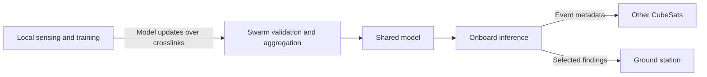

# NeuroSat

We built NeuroSat for decentralized data processing across CubeSat swarms. Our system architecture builds on [FLoBC](https://github.com/Oschart/FLoBC), a blockchain-based federated learning framework.

## Swarm architecture

We designed the swarm to train and use a shared model in orbit, with each CubeSat keeping its raw training data onboard.

1. Each CubeSat collects sensor observations and trains a local model.
2. Satellites exchange model updates over intersatellite links.
3. Validator nodes evaluate updates and coordinate a shared model through FLoBC's blockchain framework.
4. CubeSats receive the updated model for onboard inference. They exchange event metadata, such as storm detections, and send selected findings to a ground station.

We proposed using [Multi-Krum](https://papers.nips.cc/paper/6617-machine-learning-with-adversaries-byzantine-tolerant-gradient-descent) (Blanchard et al., 2017) to filter outlying model updates during aggregation.

We completed the system architecture and ran preliminary software simulations for environmental monitoring and disaster prediction. We planned further hardware testing and integration with TJ SPACE.

## Repository

The following directories are unchanged from [FLoBC's original implementation](https://github.com/Oschart/FLoBC):

- `backend/`: blockchain service and validation code.
- `lightclient/`: trainer client and model code.
- `dataset utils/`: dataset preparation utilities.
- `scripts/`: experiment and node setup scripts.
- `pictures/`: FLoBC diagrams and screenshots.

Credit for this code and these assets belongs to the FLoBC authors. The `frontend/` directory contains a Next.js starter application.

For the framework's setup instructions, see the [FLoBC README](https://github.com/Oschart/FLoBC#readme) and the [node setup script documentation](scripts/spawn/README.md).

## References

Mohamed Ghanem, Fadi Dawoud, Habiba Gamal, Eslam Soliman, Tamer El-Batt, and Hossam Sharara. "FLoBC: A Decentralized Blockchain-Based Federated Learning Framework." *2022 Fourth International Conference on Blockchain Computing and Applications (BCCA)*, pp. 85–92, 2022. [Published paper](https://doi.org/10.1109/BCCA55292.2022.9922258). [Open-access version](https://arxiv.org/abs/2112.11873).

Peva Blanchard, El Mahdi El Mhamdi, Rachid Guerraoui, and Julien Stainer. "Machine Learning with Adversaries: Byzantine Tolerant Gradient Descent." *Advances in Neural Information Processing Systems 30*, 2017. [Paper](https://papers.nips.cc/paper/6617-machine-learning-with-adversaries-byzantine-tolerant-gradient-descent).
